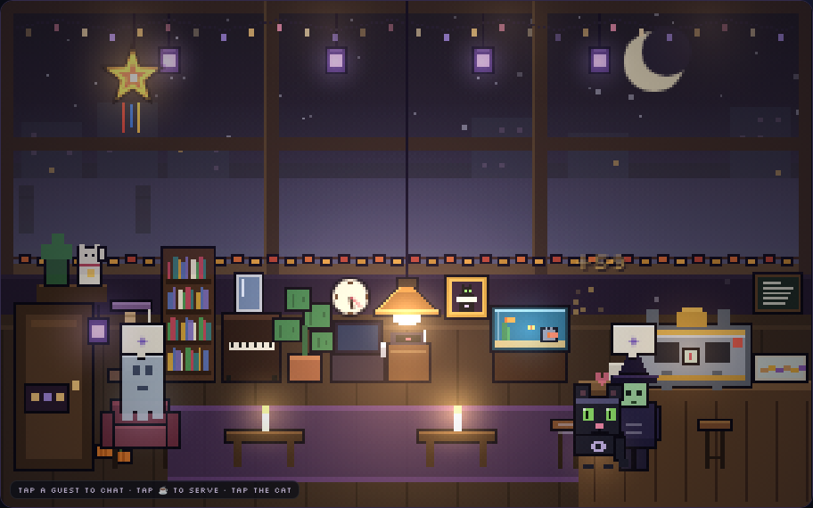
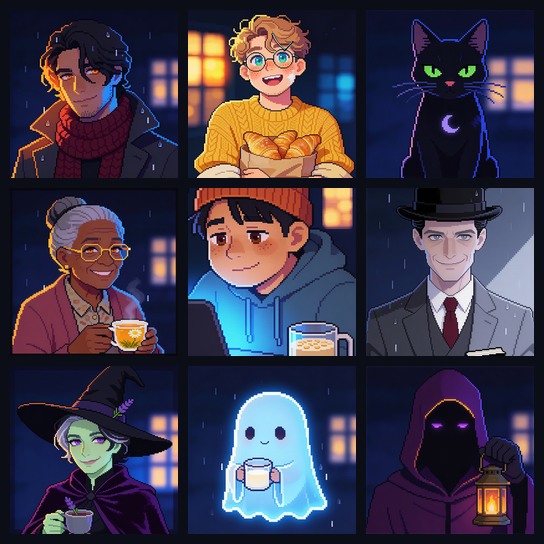

# The Midnight Roast ☾

A cozy pixel-art idle café that only opens at night. Keep it in a corner of your screen while you work: guests drift in, coins stack up, a black cat named Espresso does her rounds, and something about this place is not quite right.



## How to play

Open `index.html` in any modern browser. That's it. The whole game is one self-contained file: no install, no build step, no server.

Your progress saves automatically in your browser, so the same browser picks up where you left off, and the café keeps earning while you're away.

| Do this | What happens |
|---|---|
| Tap a guest | They talk to you. Regulars have stories that unlock one line at a time. |
| Tap a ☕ or ★ bubble | Serve the order by hand for a bigger tip. ★ special orders pay over double. |
| Tap a ✦ guest | A strange regular leaves coins and a page of lore in your journal. |
| Tap the cat (or press **P**) | Pet Espresso. Her trust unlocks perks at 20 / 45 / 70 / 100. |
| Tap things in the room | Most catalog items react: the piano plays, the fish tank… has opinions. |
| Tap the sign on the door | Toggle **quiet hours**: fewer guests, no pop-ups, a recap when you reopen. |

## What's in it

- **Idle economy:** espresso machine, seating and night lantern upgrades, with offline earnings (capped at 8 hours).
- **The Odd Little Catalog:** 25 furniture, oddity, menu and seasonal items that actually appear in the café. Seasonal items follow the real calendar (yes, there's a parol for the "ber" months).
- **Regulars and romance:** seven named regulars with their own stories, plus two love interests, Rowan and Benji, with heart meters and two chapters each.
- **Espresso the cat:** wanders, naps, sits with guests she likes, and puffs up and hisses at one she doesn't.
- **Living atmosphere:** sky and lighting follow your real clock, and the weather (fog, drizzle, rain, storms) changes on its own.
- **Generated audio:** a lofi radio (☾ 3AM FM), a second jazz station unlocked by the record player, and rain on the glass, all synthesized live with the Web Audio API. There are no audio files.

## The cast



Rowan · Benji · Espresso · Mrs. Okafor · Teo · The Accountant · Marguerite · Pip · The Lamplighter

Plus a guest from next door: **Tala** from [Studio ni Tala](../studio-ni-tala/), who usually brings her aspin Kikiam (Espresso retreats to high ground) and, once in a blue moon, her orange cat Siopao. Espresso has opinions.

## Project layout

```
midnight-roast/
├── index.html              the entire game (HTML, CSS, JS, embedded portraits)
├── portraits/
│   ├── original/           full-size 2048px portraits as generated
│   └── game/               the 168px versions embedded in index.html
└── docs/                   screenshot and cast sheet for this README
```

The in-game portraits are embedded in `index.html` as base64 WebP, so the game never loads anything from `portraits/`. That folder is there to keep the source art.

## Credits

- Pixel-art café, sprites, game code and music engine were hand-written in code with Claude (Anthropic).
- Character portraits were generated with Seedream 4.5 on OpenArt. Rowan's portrait was generated first and used as the style reference for the rest of the cast, so they all match. Tala has three portraits (with Kikiam, with Siopao, and solo), and the game shows whichever matches who she brought that night.
- Fonts: Pixelify Sans, Silkscreen and Nunito from Google Fonts.

## Status

Acts 1 and 2 are playable. Act 2, *The Lease*, starts on its own once you've heard enough stories: keep the lamp lit. Act 3 is coming.
